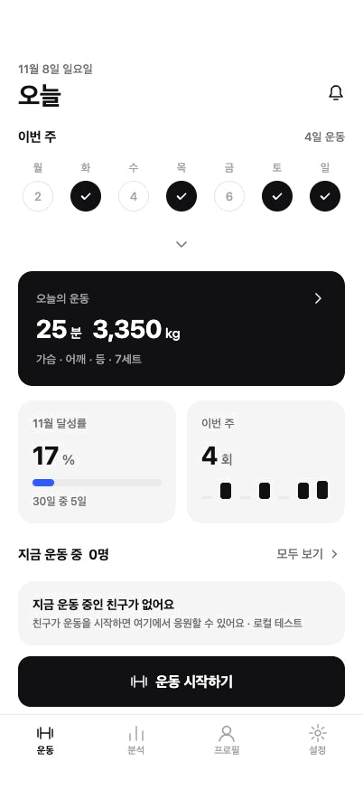
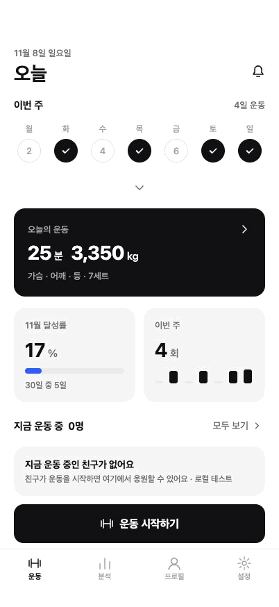
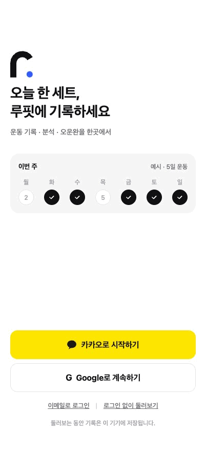
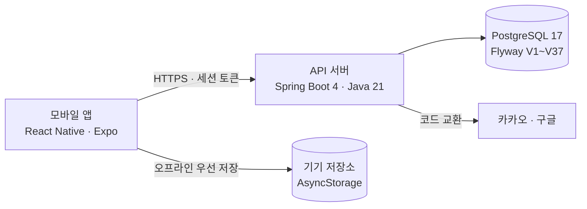

<div align="center">

# 루핏 (Rufit)

**헬스장에서 한 손으로 빠르게 남기는 운동 기록 앱**

세트 입력 · 휴식 타이머 · 운동 달력 · 삼대/체중 분석 · 오운완 기록

`React Native (Expo)` · `TypeScript` · `Java 21` · `Spring Boot 4` · `PostgreSQL 17`



</div>

---

## 프로젝트 소개

운동 중에는 휴대폰을 오래 보기 어렵습니다. 루핏은 **세트를 누르면 휴식 타이머가 자동으로 시작되고**, 지난번 기록을 옆에 보여 줘서 무게와 횟수를 고민 없이 입력할 수 있게 만든 운동 기록 앱입니다.

| 항목 | 내용 |
| --- | --- |
| 기간 | 2026.09 ~ 진행 중 |
| 역할 | 기획 · 디자인(Figma) · 프론트엔드 · 백엔드 1인 개발 |
| 플랫폼 | iOS 우선 (Android·웹 동시 지원) |
| 저장소 | 백엔드 [rufit-backend](https://github.com/yoo-jin-k/rufit-backend) · 프론트엔드 [rufit-frontend](https://github.com/yoo-jin-k/rufit-frontend) |

---

## 주요 화면

> iPhone 16 Pro 화면 크기(402×874)로 앱을 실행해 조작한 녹화입니다. 누른 위치는 회색 원으로 표시했고, 기록 데이터는 시연용 예시입니다.

### 1. 운동 기록 — 세트 입력과 자동 휴식 타이머


- 종목마다 **지난 기록**을 옆에 보여 줘서 이번 무게·횟수를 바로 정할 수 있습니다.
- 세트 체크 → **휴식 타이머 자동 시작**, ±10초 조절과 건너뛰기를 지원합니다.
- `[− 세트 N개 +]`로 마지막 세트를 복제·삭제하고, **불러오기**로 이전 기록을 한 번에 채웁니다.
- 숫자 키패드가 올라와도 입력칸이 흔들리지 않도록 스크롤 영역만 키보드만큼 조정했습니다.

<br clear="right" />

### 2. 종목 선택 — 110종 검색


- 공용 종목 110종, **별칭 240개**(예: "밀리터리 프레스" → 오버헤드프레스)로 검색합니다.
- 부위·도구 필터, 여러 종목 한 번에 추가, 내가 만든 종목 추가를 지원합니다.
- 종목마다 권장 휴식 시간을 두고, 사용자가 종목별로 바꿀 수 있습니다.

<br clear="right" />

### 3. 운동 달력과 기록



- 주간 띠와 월 달력에서 운동한 날을 표시하고, 날짜를 누르면 그날 기록을 보여 줍니다.
- 이번 달 **달성률**(운동한 날 ÷ 그 달 일수)을 함께 보여 줍니다.
- 빠뜨린 날은 **과거 기록 추가**로 나중에 입력할 수 있습니다.

<br clear="right" />

### 4. 분석 — 삼대 측정과 체중 변화


- 벤치·스쿼트·데드리프트 합계와 체중을 기록하고 추세 그래프로 보여 줍니다.
- 지난 측정 대비 증감, 4주 전 대비 체중 변화를 계산합니다.

<br clear="right" />

### 5. 오운완 기록과 친구 응원


- 운동을 마치면 사진과 한 줄 메모로 **오운완**을 남깁니다. 사진 없이도 저장할 수 있습니다.
- 친구의 오운완에 하트로 응원하고, 받은 응원은 알림으로 확인합니다.

<br clear="right" />

### 6. 로그인과 설정



- 이메일 로그인, 카카오·구글 로그인 흐름(서버 코드 교환 방식)을 구현했습니다.
- 로그인하지 않아도 기기에 기록이 저장됩니다. 기기 기록을 계정으로 옮기는 서버 API는 구현했고, 앱의 선택 화면은 다음 작업입니다.

<br clear="right" />

---

## 시스템 구성



| 영역 | 기술 |
| --- | --- |
| 프론트엔드 | React Native 0.86, Expo SDK 57, TypeScript, react-native-svg |
| 백엔드 | Java 21, Spring Boot 4.1, Spring Security, Spring Data JPA, JdbcTemplate |
| DB | PostgreSQL 17, Flyway(마이그레이션 V1~V37, 앱 테이블 37개) |
| 테스트 | 백엔드 JUnit 257개(실제 PostgreSQL), 프론트 Node test 286개 |
| 디자인 | Figma 디자인 시스템(색·간격·글자 토큰 → 코드 토큰으로 연결) |

### 백엔드 구조

```text
com.rufit
├── auth/        소셜 코드 교환 · 계정 · 자체 세션 · 갱신 · 폐기
├── workout/     운동 · 세트 · 휴식 · 이전 기록 · 집계
├── routine/     루틴 · 복사 · 루틴에서 운동 시작
├── exercise/    공용/개인 종목 · 별칭 검색 · 부위 · 도구
├── profile/     프로필 · 목표 · 휴식 설정
├── social/      친구 · 오운완 · 응원 알림 · 함께 운동 중
├── measurement/ 삼대 · 체중 측정
└── common/      공통 오류 응답 · 요청 추적
```

---

## 기술적으로 고민한 점

### 1. 헬스장 와이파이가 끊겨도 기록이 사라지지 않게

- 앱은 **기기에 먼저 저장**합니다. 서버에는 기기 기록을 계정으로 옮기는 가져오기(import) API를 두었습니다.
- 서버는 같은 요청이 재시도돼도 한 번만 저장되도록 **`Idempotency-Key`로 중복을 막고**, 원래 시각·세트·완료 상태를 그대로 보존합니다.
- 저장이 실패하면 입력을 화면에 남긴 채 다시 저장 버튼을 보여 줍니다.

### 2. 로그인 세션을 안전하게

- 카카오·구글 토큰을 앱이 직접 다루지 않고, **서버가 코드를 교환(PKCE·state·nonce 검증)** 한 뒤 일회용 handoff로 앱에 넘깁니다.
- refresh 토큰은 쓸 때마다 **회전**하고, 이미 쓴 토큰이 다시 오면 그 세션 전체를 **폐기**합니다.
- 회전·폐기는 행 잠금과 명시적 트랜잭션으로 처리해 동시 요청에서도 한 번만 성공합니다.

### 3. 동시 수정 충돌

- 운동 기록에 **수정 버전**을 두어 두 기기에서 동시에 고쳐도 늦게 온 쪽이 덮어쓰지 않게 했습니다.
- 종료된 운동은 엔티티 규칙으로 변경을 막습니다.

### 4. 종목 목록 확장 중 기존 기록 보존

- 18종 → 110종으로 늘리면서 기존 종목 ID·이미지·기록·루틴·개인 휴식 설정을 그대로 유지하도록 마이그레이션을 설계했습니다.

### 5. 모바일 사용성

- 입력할 때 화면이 흔들리는 문제를 화면 녹화 프레임 분석으로 원인(키보드 회피 방식, 자동 저장 문구의 레이아웃 밀림)을 찾아 해결했습니다.
- 모든 눌리는 영역 44pt 이상, 화면 읽기(VoiceOver) 레이블과 상태 알림을 지원합니다.

---

## 핵심 코드

### ① refresh 토큰 회전과 재사용 감지 — [`auth/AuthSessions.java`](src/main/java/com/rufit/auth/AuthSessions.java)

refresh 토큰은 한 번만 쓸 수 있습니다. **이미 쓴 토큰이 다시 오면 탈취로 보고 세션 전체를 폐기**합니다.
같은 세션의 요청이 동시에 와도 세션 행을 잠가(`SELECT … FOR UPDATE`) 한 요청만 회전에 성공합니다.

```java
public SessionView refresh(String refresh) {
  String hash = AuthCrypto.hash(refresh);          // DB에는 토큰 원문이 아니라 해시만 저장
  UUID session = knownSession(hash);
  limits.take("refresh:" + session, 12, 60);       // 세션별 1분 12회 제한

  SessionView result = tx.execute(status -> {
    Grant grant = lock(session);                    // 세션 행 잠금으로 동시 회전 직렬화
    if (grant == null || grant.revoked() || /* 만료 */ ...) return null;

    boolean used = /* 이 refresh 토큰을 이미 썼는지 */ ...;
    if (used) {                                     // 재사용 = 탈취 의심
      jdbc.update("update auth_sessions set revoked_at=? where id=?", now, session);
      return null;                                  // 폐기는 커밋된 뒤 401로 응답
    }
    jdbc.update("update auth_refresh_tokens set used_at=? where token_hash=?", now, hash);
    return issue(grant.account(), grant.owner(), session, false, now, expires); // 새 토큰 발급
  });
  // 트랜잭션 안에서 예외를 던지면 폐기까지 롤백되므로, 트랜잭션 밖에서 실패를 알립니다.
  if (result == null) throw AuthFailure.expired();
  return result;
}
```

### ② 오프라인 기록 가져오기의 중복 방지 — [`workout/WorkoutService.java`](src/main/java/com/rufit/workout/WorkoutService.java)

헬스장에서 통신이 끊기면 같은 요청이 여러 번 갈 수 있습니다. 앱이 만든 `Idempotency-Key`를 그대로 운동 ID로 쓰고,
요청 원문의 **지문(fingerprint)** 을 함께 저장해 "같은 요청의 재시도"와 "같은 키로 다른 기록을 보낸 실수"를 구분합니다.

```java
// 가져오기 원문 지문을 비교해 같은 요청 재시도는 덮어쓰기 없이 처리합니다.
public ImportResult importOffline(String owner, UUID key, OfflineImport request) {
  String fingerprint = OfflineImportFingerprint.of(request);
  var existing = repository.findByIdAndOwnerName(key, owner);
  if (existing.isPresent()) {
    if (!fingerprint.equals(existing.get().importFingerprint()))
      throw new WorkoutConflict("같은 가져오기 식별자에 다른 기록을 사용할 수 없습니다.");
    return new ImportResult(View.from(existing.get()), 0, true);   // 재시도 → 기존 결과 그대로
  }
  if (request.finishedAt() == null && /* 서버에 진행 중 운동이 있으면 */ ...)
    throw new WorkoutConflict("진행 중인 서버 운동이 있습니다. 먼저 두 기록을 확인해 주세요.");
  Workout imported = Workout.fromOffline(key, owner, request, entries, fingerprint, now);
  return new ImportResult(View.from(repository.saveAndFlush(imported)), 0, false);
}
```

### ③ 두 기기에서 동시에 고칠 때 — [`workout/Workout.java`](src/main/java/com/rufit/workout/Workout.java)

운동 엔티티에 `@Version`을 두고, 수정 요청마다 앱이 알고 있던 버전을 함께 보냅니다.
버전이 다르면 덮어쓰지 않고 409로 알려 앱이 최신 기록을 다시 불러오게 합니다.

```java
@Entity
class Workout {
  @Version
  private Long version;          // 저장할 때마다 JPA가 1씩 올림
  ...
}

// WorkoutService
checkVersion(workout, request.version());   // 앱이 본 버전과 다르면 WorkoutConflict(409)
```

### ④ 입력할 때 화면이 흔들리지 않게 — 프론트 [`components/kit/Screen.tsx`](https://github.com/yoo-jin-k/rufit-frontend/blob/main/src/components/kit/Screen.tsx)

키보드가 올라올 때 화면 높이를 줄이면(하단 버튼까지 같이 올라감) iOS의 "입력칸 보이게 스크롤"과 부딪혀 목록이 흔들렸습니다.
입력이 많은 화면은 **화면 크기는 그대로 두고 스크롤 여백만 키보드만큼 늘리는** 방식을 따로 두었습니다.

```tsx
/**
 * - lift : 화면을 줄여 하단 버튼도 키보드 위로 올림(로그인처럼 버튼이 바로 보여야 하는 화면)
 * - cover: 화면 크기는 유지하고 스크롤 영역에만 키보드 높이만큼 여백(운동 기록처럼 입력이 많은 화면)
 */
keyboard?: 'lift' | 'cover';

<ScrollView
  automaticallyAdjustKeyboardInsets={cover}          // iOS가 직접 여백·스크롤을 맞춤
  keyboardDismissMode={cover ? 'interactive' : 'none'} // 숫자 키패드엔 닫기 키가 없어 끌어서 닫기
/>
```

원인은 실제 아이폰 화면 녹화를 0.1초 단위 프레임으로 잘라 스크롤 위치를 수치로 추적해 찾았습니다.

---

## 실행 방법

```sh
# 백엔드
docker compose up -d          # PostgreSQL (DB_PASSWORD 환경변수 필요)
./mvnw spring-boot:run        # http://127.0.0.1:8080/actuator/health

# 프론트엔드 (Node 24)
npm ci
npm start                     # 개발 서버, 아이폰 개발용 앱에서 접속
```

---

## 현재 상태와 다음 계획

| 상태 | 내용 |
| --- | --- |
| 완료 | 운동 기록 · 휴식 타이머 · 종목 110종 검색 · 달력 · 분석 · 오운완 · 세션 인증 API |
| 진행 중 | 실제 카카오·구글 앱 등록과 실기기 로그인, 운영 서버 배포, 기기 기록 가져오기 화면 |
| 예정 | 종목별 동작 이미지·GIF, 루틴 화면, App Store 출시 |

> 운영 배포 전 단계의 개인 프로젝트입니다. 위 기능은 로컬 서버와 실제 아이폰에서 확인했습니다.

상세 개발 문서(API 계약·DB 구조·검증 방법)는 [docs/development.md](docs/development.md)에 정리했습니다.
