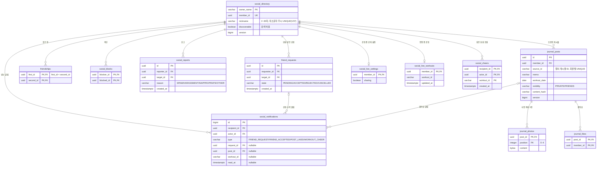

# 루핏 데이터베이스 구조와 ERD

기준: PostgreSQL용 Flyway V1~V37(2026-11-09). 운동·루틴·종목·프로필, 소셜 로그인·이메일 로그인·계정 병합, 기록 이전·체중/삼대 측정, 친구·오운완·알림·응원을 포함합니다. Flyway가 관리하는 `flyway_schema_history`를 제외한 애플리케이션 테이블은 37개입니다.

| 묶음 | 테이블 수 | 도입 | 설명 위치 |
| --- | --- | --- | --- |
| 운동·루틴 업무 | 14 | V1~V23 | 아래 업무 도표 |
| 종목 검색 색인 | 1 | V26 | 운동 검색 색인 |
| 인증(소셜·이메일·병합) | 9 | V24·V25·V34·V36 | 인증 원장 |
| 측정 | 1 | V27 | 기록 이전과 측정 |
| 친구·소셜 | 12 | V28~V33 | 친구·소셜 데이터 |

## 운동·루틴 업무 데이터 관계

아래 업무 도표는 운동·루틴 14개 테이블의 실제 SQL 외래 키를 표시합니다. 인증·측정·소셜 테이블은 하단 절에 따로 정리합니다. PK는 기본 키, FK는 외래 키이며 여러 PK 열을 가진 테이블은 해당 열을 묶어 기본 키로 사용합니다. 숫자 크기·NULL 허용·CHECK 조건의 원본은 `src/main/resources/db/migration`입니다.

```mermaid
erDiagram
    workouts ||--o{ workout_entries : "운동별 세트"
    workouts ||--o{ completed_workout_sets : "완료한 세트 번호"
    workouts ||--o{ workout_draft_operations : "초안 저장 확인"
    routines ||--o{ routine_entries : "루틴별 세트"
    exercises |o--o{ workout_entries : "선택한 종목"
    exercises |o--o{ routine_entries : "선택한 종목"
    exercises ||--o{ exercise_rest_preferences : "종목별 개인 휴식"
    user_profiles ||--o{ profile_goals : "프로필 목표"

    workouts {
        uuid id PK
        varchar owner_name
        timestamptz started_at
        timestamptz finished_at "nullable"
        timestamptz cancelled_at "nullable"
        timestamptz paused_at "nullable, explicit pause"
        bigint paused_duration_ms "default 0"
        bigint version
        timestamptz rest_ends_at "nullable"
        integer rest_set_index "nullable"
        uuid source_routine_id "nullable, source snapshot"
        uuid last_draft_operation_id "nullable"
        varchar import_fingerprint "nullable, SHA-256 of import request"
        varchar note
        date record_date "nullable, manual past entry"
        varchar entry_mode "nullable, manual"
    }
    workout_entries {
        uuid workout_id PK,FK
        integer entry_order PK
        varchar exercise_name
        numeric weight
        integer reps
        uuid exercise_id FK "nullable"
    }
    completed_workout_sets {
        uuid workout_id PK,FK
        integer set_index PK
    }
    workout_draft_operations {
        uuid workout_id PK,FK
        uuid operation_id PK
        bigint applied_version
        timestamptz applied_at
    }
    routines {
        uuid id PK
        varchar owner_name
        varchar title
        bigint version
        uuid source_routine_id "nullable, source snapshot"
        uuid source_workout_id "nullable, source snapshot"
    }
    routine_entries {
        uuid routine_id PK,FK
        integer entry_order PK
        varchar exercise_name
        numeric weight
        integer reps
        uuid exercise_id FK "nullable"
    }
    exercises {
        uuid id PK
        varchar owner_name "null means public catalog"
        varchar name
        varchar body_part
        varchar equipment
        integer recommended_rest_seconds "nullable"
        timestamptz archived_at "nullable"
        bigint version
    }
    user_profiles {
        varchar owner_name PK
        uuid creation_key
        varchar nickname
        varchar bio
        varchar experience "nullable"
        bigint version
    }
    profile_goals {
        varchar owner_name PK,FK
        varchar goal PK
    }
    rest_preferences {
        varchar owner_name PK
        integer default_rest_seconds
        bigint version
    }
    exercise_rest_preferences {
        varchar owner_name PK
        uuid exercise_id PK,FK
        integer rest_seconds "nullable means recommendation"
        bigint version
    }
    retired_workout_keys {
        uuid id PK
        varchar owner_name
        timestamptz deleted_at
    }
    retired_routine_keys {
        uuid id PK
        varchar owner_name
        timestamptz deleted_at
    }
    application_metadata {
        varchar name PK
        varchar value
    }
```

## 테이블의 역할

| 테이블 | 보관하는 내용 |
| --- | --- |
| workouts | 한 번의 운동: 소유자, 시작·종료·취소·정지, 누적 정지시간, 메모, 휴식, 수정 버전 |
| workout_entries | 운동에 입력한 순서별 세트: 종목, 무게, 횟수 |
| completed_workout_sets | 운동에서 완료 표시한 세트 번호 |
| workout_draft_operations | 같은 초안 요청을 재전송해도 중복 적용하지 않기 위한 저장 확인 |
| routines / routine_entries | 루틴과 루틴에 속한 순서별 세트 |
| exercises | 공용·개인 운동 종목, 부위, 도구, 보관 상태 |
| user_profiles / profile_goals | 비공개 프로필과 운동 목표 |
| rest_preferences | 계정별 기본 휴식 시간 |
| exercise_rest_preferences | 종목별 개인 지정 휴식시간, 추천 사용 복귀 후에도 수정 버전 유지 |
| retired_workout_keys / retired_routine_keys | 삭제된 기록의 UUID 재사용 방지. 운동 내용은 보관하지 않음 |
| application_metadata | 애플리케이션 식별 정보 |

운동 한 번에 세트가 여러 개 들어가고, 세트는 종목을 선택하거나 이름을 직접 입력합니다. 따라서 `exercise_id`는 NULL일 수 있습니다. `exercise_name`은 기록 당시 이름을 함께 보관합니다. 무게는 `numeric(6,2)`로 저장하며 0~1500, 횟수는 1~1000 범위입니다. 순서와 완료 번호는 0부터 시작하고 세트 수는 서비스에서 최대 300개로 제한합니다.

## 실제 FK와 구분할 관계

- 업무 테이블은 회원 테이블을 FK로 참조하지 않습니다. 회원 원장 `auth_accounts`(V24)의 `owner_key`와 같은 내부 소유권 키를 `owner_name`에 저장합니다. 표시 이름이나 이메일이 아닙니다. 프로필을 만들지 않아도 운동 기록이 가능하므로 workouts/routines/rest_preferences의 owner_name은 user_profiles를 참조하는 FK가 아닙니다.
- workouts.source_routine_id, routines.source_routine_id, routines.source_workout_id는 복사 출처를 기억하는 값입니다. 원본을 지워도 복사본이 유지되도록 FK를 걸지 않았습니다. 루틴의 두 출처는 동시에 채울 수 없습니다.
- completed_workout_sets.set_index와 workouts.rest_set_index는 세트 순서 번호입니다. workout_entries로 향하는 복합 FK는 없으며, 세트 교체·복제·삭제 시 애플리케이션 규칙과 트랜잭션에서 일관성을 관리합니다.
- workouts.import_fingerprint는 최초 오프라인 가져오기 요청을 구분하는 SHA-256 값입니다. 재시도에서 같은 ID에 다른 원문을 적용하지 않도록 하며 API에는 노출하지 않습니다. 별도 FK나 새 테이블은 없습니다.
- workouts.last_draft_operation_id에는 FK가 없습니다. 초안 저장이 낙관적 잠금에 참여하도록 운동 엔티티를 변경하는 표식이고, 적용 확인은 workout_draft_operations에 저장합니다.
- 삭제 방지 키는 원본 운동/루틴이 지워진 뒤에도 남아야 하므로 원본 테이블과 FK로 연결하지 않습니다.

## 저장과 변경 규칙

- Flyway의 V1~V37 SQL로 구조와 초기 종목을 관리합니다. Hibernate는 `ddl-auto=validate`로 구조를 검사하며 테이블을 임의 생성·수정하지 않습니다.
- 운동·루틴·종목·프로필은 수정 버전으로 동시 덮어쓰기를 막습니다. 서비스 트랜잭션은 복수 테이블 변경을 함께 처리합니다.
- 종료/취소 시각의 순서를 DB CHECK로 제한하고, 계정별 진행 중 운동은 부분 UNIQUE 인덱스로 최대 하나만 허용합니다.
- 운동/루틴의 하위 세트, 운동 완료 번호·저장 확인, 프로필 목표는 부모 삭제 시 함께 삭제합니다. 종목 참조는 CASCADE 삭제가 아니며 종목은 보관 상태를 사용합니다.
- 종목 검색 사진은 현재 프론트 자산입니다. 이미지 파일이나 이미지 URL을 저장하는 DB 테이블/열은 아직 없습니다.

## DB 환경과 운영 상태

| 구분 | 현재 상태 |
| --- | --- |
| 로컬 개발 구성 | Docker Compose의 PostgreSQL 17, DB `rufit`, 로컬 포트 5433, 데이터 볼륨 유지 |
| 실제 기능 시험 | 별도 컨테이너의 `rufit_test` DB와 같은 이름의 계정, 인증 작업은 독립 컨테이너5437에서 검증. 기존5435는 FE 인계 자원 |
| 개발 서버 DB | AWS 개발 서버의 Docker Compose PostgreSQL 17(컨테이너 내부 포트). 정식 운영 DB가 아니며 정기 백업·보존 정책은 미확정 |
| 연결 정보 | DB_URL / DB_USERNAME / DB_PASSWORD 환경변수. 비밀번호를 코드에 넣지 않음 |
| 백업·복원 | 시험 DB를 임시 DB에 복원해 데이터/스키마 일치를 확인한 도구와 검사 존재 |
| 운영에 남은 일 | 호스팅·네트워크·TLS·접근 권한·정기 백업/보존/복구 목표 확정 및 검증 |

운영 데이터는 시험에 사용하지 않습니다. 시험 초기화 전에 루프백 주소, DB와 계정 이름 `rufit_test`를 검사합니다. 운영 환경의 회원·탈퇴·계정 연결과 보존 정책은 후속 설계이며, 이 문서의 소유권 키 및 삭제 방지 메타데이터 처리에도 영향을 줍니다.

관련 문서: [인증](authentication.md), [운동 API](workout-api.md), [백업·복원 검증](backup-restore.md), [컨테이너 실행](container-runtime.md).

## 인증 원장 (V24/V25/V34/V36)

| 테이블 | 주요 열·관계 | 보존/역할 |
| --- | --- | --- |
| auth_accounts | UUID id, UNIQUE owner_key(100), created_at | 기존69자 owner 키를 보존하는 회원 원장 |
| auth_identities | PK(provider,issuer,subject), account_id → auth_accounts | 이메일 자동 연결 없음 |
| auth_sessions | UUID id, account_id → auth_accounts, 생성/미사용/절대기한, revoked_at | JWT sid에 해당하는 grant. 매 인증마다 활성 검사 |
| auth_refresh_tokens | PK token_hash, session_id → auth_sessions ON DELETE CASCADE, used_at | 원문 없음. 과거 해시는 절대기한+30초까지 보존 |
| auth_login_attempts | state/nonce/handoff 해시, 암호화 provider verifier, challenge, status/기한 | 소비와 회원/세션 생성은 한 트랜잭션. 만료 비밀 제거, 메타데이터24시간 후 정리 |
| auth_rate_events | bucket_hash, occurred_at | 공유 이동 구간 제한. 1시간 이후 카운터 정리 |
| auth_email_credentials | PK account_id → auth_accounts, UNIQUE email, password_hash | 이메일 로그인 계정. 비밀번호 원문 없음 (V34) |
| auth_email_requests | UUID id, email, purpose(REGISTER/RESET/LINK), token_hash, 만료·소비 여부 | 가입·재설정·연결 메일 확인. 토큰 원문 없음 (V34) |
| auth_account_merges | PK source_account → auth_accounts, target_account → auth_accounts, snapshot(jsonb), merged_at | 계정 병합 이력. 합치기 전 상태를 보관 (V36) |

업무 테이블의 owner_name을 auth_accounts로 강제 FK 전환하지 않았습니다. 기존 OIDC 소유권과 과거 기록을 유지하며 새 세션이 같은 owner_key를 principal로 사용합니다. 계정·identity는 세션 정리로 삭제하지 않습니다. 운영 탈퇴/보존 정책은 별도입니다. FE fake 로그인 preview는 자동 테스트 DB와 별도 전용 볼륨을 사용합니다.

## 운동 검색 색인 (V26)

`exercise_search_aliases`는 공용110종의 정규화한 이름/별칭240개를 보관합니다. id(bigserial PK), exercise_id(FK → exercises, 삭제 시 CASCADE), normalized_alias(varchar160), UNIQUE(exercise_id,normalized_alias)입니다. 검색은 EXISTS로 연결하므로 한 종목이 여러 별칭에 맞아도 페이지/총수가 중복되지 않습니다. V26은 신규92종만 추가하며 기존18행·업무기록·개인휴식은 갱신하지 않습니다.

## 기록 이전과 측정 (V27)

- `workouts`에 `record_date`, `entry_mode`를 추가했습니다. 지난 날짜에 직접 입력한 기록은 `entry_mode='manual'`이고, 시작·종료 시각이 같으며 정지 시간이 0이어야 합니다(CHECK).
- `measurements`는 PK(owner_name, kind, record_date)로 하루 한 건만 저장합니다. kind가 `weight`면 체중(0 초과 700 이하)만, `strength`면 벤치·스쿼트·데드리프트(각 0 초과 1000 이하)만 채웁니다. 수정 버전을 둡니다.

## 친구·소셜 데이터 (V28~V33, V37)

소셜 테이블은 `owner_name` 대신 공개용 `member_id`로 서로를 참조합니다. 내부 소유권 키를 다른 회원에게 노출하지 않기 위해서입니다.

- 모든 소셜 FK는 `social_directory` 행이 지워지면 함께 지워집니다(ON DELETE CASCADE).
- 같은 두 사람 사이의 대기 중 친구 신청은 방향과 관계없이 하나만 허용합니다(부분 UNIQUE 인덱스). 친구 쌍은 작은 ID를 `first_id`에 두어 중복 저장을 막습니다.
- 자기 자신에게 신청·차단·신고·알림·응원할 수 없습니다(CHECK).
- 알림은 종류마다 연결 대상이 하나만 채워지도록 CHECK로 제한합니다. 같은 좋아요·응원 알림은 한 번만 만듭니다.
- 오운완 사진은 DB에 `bytea`로 저장합니다. 게시물 하나에 최대 5장입니다.
