# 루핏 데이터베이스 구조와 ERD

기준: PostgreSQL용 Flyway V1~V20, 백엔드 기능 기준 커밋 `fca7dbeb7c6a83bb921ce35e8d613d6de8289aef`. 운영 DB를 배포한 상태가 아니라 현재 구현된 스키마를 설명한다. Flyway가 관리하는 `flyway_schema_history`를 제외한 애플리케이션 테이블은 13개다.

## 데이터 관계

아래 선은 실제 SQL 외래 키만 표시한다. PK는 기본 키, FK는 외래 키이며 여러 PK 열을 가진 테이블은 해당 열을 묶어 기본 키로 사용한다. 숫자 크기·NULL 허용·CHECK 조건의 원본은 `src/main/resources/db/migration`이다.

```mermaid
erDiagram
    workouts ||--o{ workout_entries : "운동별 세트"
    workouts ||--o{ completed_workout_sets : "완료한 세트 번호"
    workouts ||--o{ workout_draft_operations : "초안 저장 확인"
    routines ||--o{ routine_entries : "루틴별 세트"
    exercises |o--o{ workout_entries : "선택한 종목"
    exercises |o--o{ routine_entries : "선택한 종목"
    user_profiles ||--o{ profile_goals : "프로필 목표"

    workouts {
        uuid id PK
        varchar owner_name
        timestamptz started_at
        timestamptz finished_at "nullable"
        timestamptz cancelled_at "nullable"
        bigint version
        timestamptz rest_ends_at "nullable"
        integer rest_set_index "nullable"
        uuid source_routine_id "nullable, source snapshot"
        uuid last_draft_operation_id "nullable"
        varchar note
    }
    workout_entries {
        uuid workout_id PK,FK
        integer entry_order PK
        varchar exercise_name
        numeric weight
        integer reps
        uuid exercise_id FK "nullable"
    }
    completed_workout_sets {
        uuid workout_id PK,FK
        integer set_index PK
    }
    workout_draft_operations {
        uuid workout_id PK,FK
        uuid operation_id PK
        bigint applied_version
        timestamptz applied_at
    }
    routines {
        uuid id PK
        varchar owner_name
        varchar title
        bigint version
        uuid source_routine_id "nullable, source snapshot"
        uuid source_workout_id "nullable, source snapshot"
    }
    routine_entries {
        uuid routine_id PK,FK
        integer entry_order PK
        varchar exercise_name
        numeric weight
        integer reps
        uuid exercise_id FK "nullable"
    }
    exercises {
        uuid id PK
        varchar owner_name "null means public catalog"
        varchar name
        varchar body_part
        varchar equipment
        timestamptz archived_at "nullable"
        bigint version
    }
    user_profiles {
        varchar owner_name PK
        uuid creation_key
        varchar nickname
        varchar bio
        varchar experience "nullable"
        bigint version
    }
    profile_goals {
        varchar owner_name PK,FK
        varchar goal PK
    }
    rest_preferences {
        varchar owner_name PK
        integer default_rest_seconds
        bigint version
    }
    retired_workout_keys {
        uuid id PK
        varchar owner_name
        timestamptz deleted_at
    }
    retired_routine_keys {
        uuid id PK
        varchar owner_name
        timestamptz deleted_at
    }
    application_metadata {
        varchar name PK
        varchar value
    }
```

## 테이블의 역할

| 테이블 | 보관하는 내용 |
| --- | --- |
| workouts | 한 번의 운동: 소유자, 시작·종료·취소, 메모, 휴식, 수정 버전 |
| workout_entries | 운동에 입력한 순서별 세트: 종목, 무게, 횟수 |
| completed_workout_sets | 운동에서 완료 표시한 세트 번호 |
| workout_draft_operations | 같은 초안 요청을 재전송해도 중복 적용하지 않기 위한 저장 확인 |
| routines / routine_entries | 루틴과 루틴에 속한 순서별 세트 |
| exercises | 공용·개인 운동 종목, 부위, 도구, 보관 상태 |
| user_profiles / profile_goals | 비공개 프로필과 운동 목표 |
| rest_preferences | 계정별 기본 휴식 시간 |
| retired_workout_keys / retired_routine_keys | 삭제된 기록의 UUID 재사용 방지. 운동 내용은 보관하지 않음 |
| application_metadata | 애플리케이션 식별 정보 |

운동 한 번에 세트가 여러 개 들어가고, 세트는 종목을 선택하거나 이름을 직접 입력한다. 따라서 `exercise_id`는 NULL일 수 있다. `exercise_name`은 기록 당시 이름을 함께 보관한다. 무게는 `numeric(6,2)`로 저장하며 0~1500, 횟수는 1~1000 범위다. 순서와 완료 번호는 0부터 시작하고 세트 수는 서비스에서 최대 300개로 제한한다.

## 실제 FK와 구분할 관계

- 별도 회원 원장인 `users` 테이블은 아직 없다. OIDC의 발급자와 subject로 만든 내부 소유권 키를 `owner_name`에 저장한다. 표시 이름이나 이메일이 아니다. 프로필을 만들지 않아도 운동 기록이 가능하므로 workouts/routines/rest_preferences의 owner_name은 user_profiles를 참조하는 FK가 아니다.
- workouts.source_routine_id, routines.source_routine_id, routines.source_workout_id는 복사 출처를 기억하는 값이다. 원본을 지워도 복사본이 유지되도록 FK를 걸지 않았다. 루틴의 두 출처는 동시에 채울 수 없다.
- completed_workout_sets.set_index와 workouts.rest_set_index는 세트 순서 번호다. workout_entries로 향하는 복합 FK는 없으며, 세트 교체·복제·삭제 시 애플리케이션 규칙과 트랜잭션에서 일관성을 관리한다.
- workouts.last_draft_operation_id에는 FK가 없다. 초안 저장이 낙관적 잠금에 참여하도록 운동 엔티티를 변경하는 표식이고, 적용 확인은 workout_draft_operations에 저장한다.
- 삭제 방지 키는 원본 운동/루틴이 지워진 뒤에도 남아야 하므로 원본 테이블과 FK로 연결하지 않는다.

## 저장과 변경 규칙

- Flyway의 V1~V20 SQL로 구조와 초기 종목을 관리한다. Hibernate는 `ddl-auto=validate`로 구조를 검사하며 테이블을 임의 생성·수정하지 않는다.
- 운동·루틴·종목·프로필은 수정 버전으로 동시 덮어쓰기를 막는다. 서비스 트랜잭션은 복수 테이블 변경을 함께 처리한다.
- 종료/취소 시각의 순서를 DB CHECK로 제한하고, 계정별 진행 중 운동은 부분 UNIQUE 인덱스로 최대 하나만 허용한다.
- 운동/루틴의 하위 세트, 운동 완료 번호·저장 확인, 프로필 목표는 부모 삭제 시 함께 삭제한다. 종목 참조는 CASCADE 삭제가 아니며 종목은 보관 상태를 사용한다.
- 종목 검색 사진은 현재 프론트 자산이다. 이미지 파일이나 이미지 URL을 저장하는 DB 테이블/열은 아직 없다.

## DB 환경과 운영 상태

| 구분 | 현재 상태 |
| --- | --- |
| 로컬 개발 구성 | Docker Compose의 PostgreSQL 17, DB `rufit`, 로컬 포트 5433, 데이터 볼륨 유지 |
| 실제 기능 시험 | 별도 컨테이너의 `rufit_test` DB와 같은 이름의 계정, 로컬 포트 5435에서 검증 |
| 운영 DB | 생성·연결·배포하지 않음. 운영 제공자와 접속 정보 미설정 |
| 연결 정보 | DB_URL / DB_USERNAME / DB_PASSWORD 환경변수. 비밀번호를 코드에 넣지 않음 |
| 백업·복원 | 시험 DB를 임시 DB에 복원해 데이터/스키마 일치를 확인한 도구와 검사 존재 |
| 운영에 남은 일 | 호스팅·네트워크·TLS·접근 권한·정기 백업/보존/복구 목표 확정 및 검증 |

운영 데이터는 시험에 사용하지 않는다. 시험 초기화 전에 루프백 주소, DB와 계정 이름 `rufit_test`를 검사한다. 운영 환경의 회원·탈퇴·계정 연결과 보존 정책은 후속 설계이며, 이 문서의 소유권 키 및 삭제 방지 메타데이터 처리에도 영향을 준다.

관련 문서: [인증](authentication.md), [운동 API](workout-api.md), [백업·복원 검증](backup-restore.md), [컨테이너 실행](container-runtime.md).
